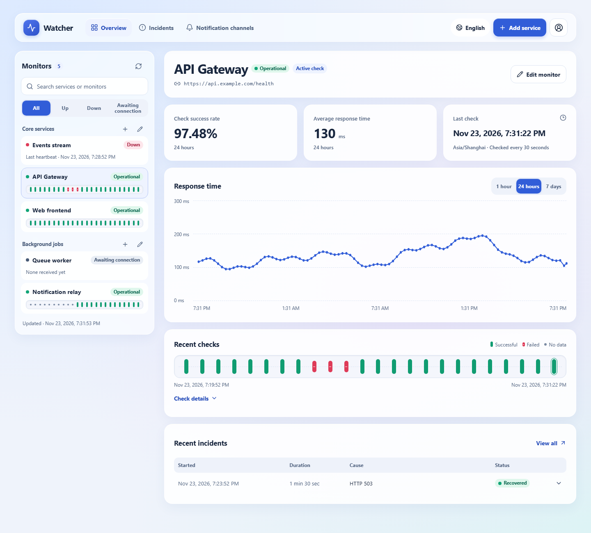
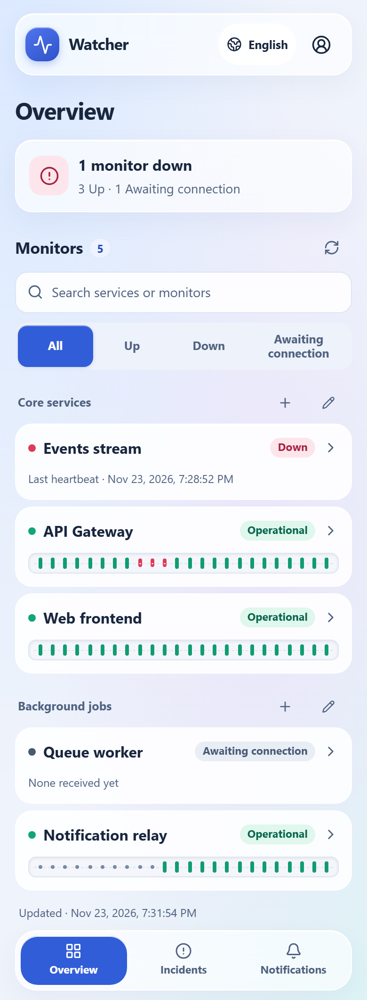

# Watcher

English · [简体中文](README.zh-CN.md)

Watcher monitors HTTP endpoints and application heartbeats, records incidents, and alerts you when a service fails or recovers. The responsive dashboard runs on Next.js, Tailwind CSS, and PostgreSQL.

[Dashboard](#dashboard) · [Quick start](#quick-start) · [Deploy to Vercel](#deploy-to-vercel) · [Passive monitoring](#passive-monitoring)

## Dashboard



The monitor list stays beside the selected monitor on desktop. The recent-check strip shows successful checks as green capsules, failures as rose capsules with a short dash, and missing records as gray dots. A new result receives a brief outline pulse. The outline stays static when the system requests reduced motion.

<details>
<summary>Mobile dashboard</summary>

The mobile overview puts active failures at the top. Tap a monitor for its details, or switch between the overview, incidents, and notifications from the bottom bar.



</details>

*Screenshots show the running app with sample monitoring data.*

## Monitoring

| Mode | How it works |
| --- | --- |
| Active HTTP(S) | Checks a public endpoint every 30 seconds against configurable HTTP status codes. Two consecutive failures open an incident. The next successful check closes it. |
| Passive WebSocket | Accepts application heartbeats and explicit health reports. A 15-second gap triggers a failure once the first valid report has arrived. |

HTTP monitor details include response times and check success rates for 1 hour, 24 hours, or 7 days. Watcher retains check records for 7 days. Each monitor can send failure and recovery alerts through multiple [notification channels](#notification-channels).

## Quick start

**Requirements:** Node.js 22.18 or later, PostgreSQL 14 or later, and a GitHub OAuth app.

### Install

```sh
git clone https://github.com/lyxlucky/watcher.git
cd watcher
npm ci
cp .env.example .env.local
```

### Configure

Create a GitHub OAuth app with homepage `http://localhost:3000` and callback `http://localhost:3000/api/auth/callback/github`. Copy its client ID and secret into the local environment. [GitHub OAuth app setup](https://docs.github.com/en/apps/oauth-apps/building-oauth-apps/creating-an-oauth-app)

| Variable | Local value |
| --- | --- |
| `AUTH_URL` | `http://localhost:3000` |
| `AUTH_GITHUB_ID`, `AUTH_GITHUB_SECRET` | GitHub OAuth app client ID and client secret |
| `AUTH_SECRET`, `CHANNEL_SECRET_KEY` | Two independently generated secrets |
| `ADMIN_GITHUB_IDS` | Comma-separated numeric GitHub user IDs allowed to edit configuration |
| `DATABASE_URL` | Connection URL for your PostgreSQL database |

Generate a value for each secret with this command.

```sh
node -e "console.log(require('node:crypto').randomBytes(32).toString('base64'))"
```

Anyone who signs in with GitHub can view monitoring data. Only the accounts listed in `ADMIN_GITHUB_IDS` can change the configuration. See [the environment template](.env.example) for the optional SMTP settings.

### Start

Run `npm run db:migrate` once to apply the schema. Then start each process you need in a separate terminal.

| Command | Purpose |
| --- | --- |
| `npm run dev` | Start the [dashboard](http://localhost:3000) |
| `npm run worker` | Run checks, detect expired heartbeats, and deliver alerts |
| `npm run dev:ws` | Accept passive monitor connections on port 3001 |

## Deploy to Vercel

[`vercel.json`](vercel.json) deploys the Next.js app and the worker to one Vercel project. Both default to `iad1`. If your database is elsewhere, update both `regions` and the Daemon’s `instances` region. The Daemon runs in production deployments. [Vercel Daemons documentation](https://vercel.com/docs/daemons)

1. Set the production environment variables. Point `AUTH_URL` to the HTTPS deployment origin and use `https://your-domain.example/api/auth/callback/github` as the OAuth callback. Enable Fluid compute for passive monitoring. [Vercel WebSocket documentation](https://vercel.com/docs/functions/websockets)
2. Run `npm run db:migrate` with the production database connection, then deploy through Vercel’s Git integration or run `vercel --prod`. Check the logs for `Watcher 监控进程已启动`.
3. Sign in as an administrator, create a service and a notification channel, and add a monitor. Verify failure and recovery alerts with a test destination.

Use the same `DATABASE_URL` and `CHANNEL_SECRET_KEY` for the app and Daemon. Preserve the channel key across deployments so Watcher can still decrypt existing destinations.

## Passive monitoring

Connect to `ws://127.0.0.1:3001/api/heartbeat` locally or `wss://your-domain.example/api/heartbeat` in production. Save the token shown when you create the monitor and send `Authorization: Bearer <token>` in the WebSocket handshake. Send one JSON text frame every 5 seconds. Watcher replies with `{"type":"ack"}` after recording it.

| Frame | Effect |
| --- | --- |
| `{"type":"heartbeat"}` | Refreshes the last heartbeat time and can clear a heartbeat timeout. |
| `{"type":"unhealthy"}` | Reports an unhealthy state and opens an incident when the monitor enters that state. |
| `{"type":"healthy"}` | Reports a healthy state and clears an explicit failure. |

Reconnect after disconnects and report the application’s current state promptly. Watcher measures the timeout from receipt of the last valid report and checks for expired heartbeats every 250 milliseconds. Database operations, deployments, and notification services can affect alert timing.

## Notification channels

| Channel | Configuration |
| --- | --- |
| Bark | A push URL with the device key, such as `https://api.day.app/device-key`. [Bark documentation](https://bark.day.app/) |
| Webhook | A public HTTP(S) endpoint. Use the `Idempotency-Key` header to deduplicate deliveries. |
| Email | A recipient address and the worker’s `SMTP_*` settings. Port 465 uses implicit TLS. The default port, 587, uses STARTTLS. |

Webhook events are `down` or `recovery`. The JSON body includes `id`, `incidentId`, `event`, `service`, `monitor`, `reason`, and `occurredAt`.

Each channel gets up to three delivery attempts, with retries after approximately 15 and 30 seconds. A retry can produce a duplicate when the destination accepted the notification but Watcher could not record it.

## Development

| Command | Purpose |
| --- | --- |
| `npm test` | Run monitoring and delivery tests using an embedded database |
| `npm run typecheck` | Run TypeScript checks |
| `npm run build` | Verify the production build |

The dashboard and API routes are in [`app/`](app/). The worker, database schema, and alert delivery code are in [`worker/`](worker/). Tests are in [`tests/`](tests/).

[Monitoring rules (Chinese)](docs/monitoring.md) · [Vercel scheduling decision (Chinese)](docs/adr/0001-vercel-daemon-for-scheduling.md)
