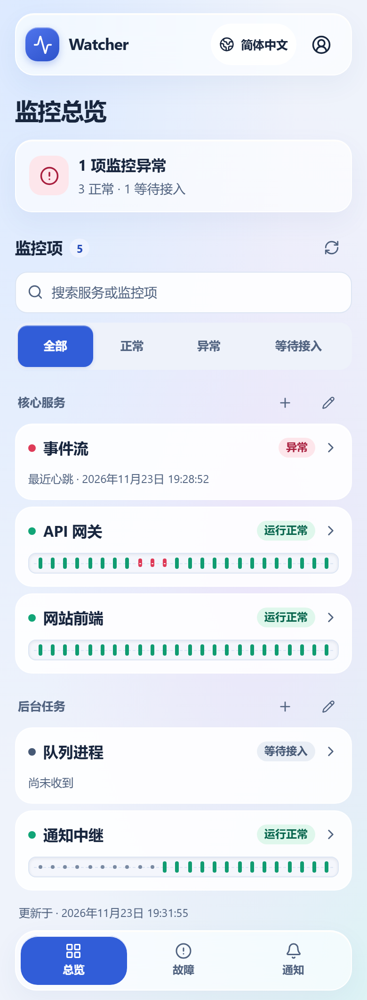

# Watcher

[English](README.md) · 简体中文

Watcher 监控 HTTP 接口和应用心跳，记录故障，并在服务故障或恢复时发送通知。响应式控制台基于 Next.js、Tailwind CSS 和 PostgreSQL。

[界面预览](#界面预览) · [快速开始](#快速开始) · [部署到 Vercel](#部署到-vercel) · [被动接入](#被动接入)

## 界面预览


桌面端将监控列表和选中项的详情并排显示。近期探测条用绿色胶囊表示成功，带短横的玫红胶囊表示失败，灰点表示暂无记录。新结果会带来一次短暂的光晕，系统开启「减少动态效果」后显示静态描边。

<details>
<summary>手机端控制台</summary>

手机端总览会将当前异常放在顶部。点按监控项可查看详情，底部导航可切换总览、故障记录和通知渠道。



</details>

*截图来自运行中的控制台，使用示例监控数据。*

## 监控方式

| 方式 | 监控规则 |
| --- | --- |
| 主动 HTTP(S) 探测 | 每 30 秒访问一次公网地址，根据配置的 HTTP 状态码判断结果。连续两次失败会创建故障，下一次成功时关闭故障。 |
| 被动 WebSocket 监控 | 接收应用心跳和显式健康上报。收到首次有效上报后，15 秒未收到心跳即判定异常。 |

主动探测详情支持查看 1 小时、24 小时和 7 天的响应时间和探测成功率。探测明细保留 7 天。每个监控项可通过多个[告警渠道](#告警渠道)发送故障和恢复通知。

## 快速开始

**运行要求**为 Node.js 22.18 或更新版本、PostgreSQL 14 或更新版本，以及一个 GitHub OAuth App。

### 安装

```sh
git clone https://github.com/lyxlucky/watcher.git
cd watcher
npm ci
cp .env.example .env.local
```

### 配置

创建 GitHub OAuth App，主页设为 `http://localhost:3000`，回调设为 `http://localhost:3000/api/auth/callback/github`。将 Client ID 和 Client Secret 填入本地环境配置。[GitHub OAuth App 创建文档](https://docs.github.com/en/apps/oauth-apps/building-oauth-apps/creating-an-oauth-app)

| 变量 | 本地配置 |
| --- | --- |
| `AUTH_URL` | `http://localhost:3000` |
| `AUTH_GITHUB_ID`、`AUTH_GITHUB_SECRET` | GitHub OAuth App 的 Client ID 和 Client Secret |
| `AUTH_SECRET`、`CHANNEL_SECRET_KEY` | 分别生成的两个独立密钥 |
| `ADMIN_GITHUB_IDS` | 可编辑配置的 GitHub 用户数字 ID，多个 ID 用逗号分隔 |
| `DATABASE_URL` | PostgreSQL 数据库连接地址 |

分别运行以下命令，为两个密钥各生成一个值。

```sh
node -e "console.log(require('node:crypto').randomBytes(32).toString('base64'))"
```

任意 GitHub 用户登录后可查看监控数据。`ADMIN_GITHUB_IDS` 中的用户可以修改配置。可选的 SMTP 配置见[环境变量模板](.env.example)。

### 启动

先执行 `npm run db:migrate` 应用数据库结构，再在不同终端启动所需进程。

| 命令 | 用途 |
| --- | --- |
| `npm run dev` | 启动[本地控制台](http://localhost:3000) |
| `npm run worker` | 执行主动探测、判定心跳超时和投递告警 |
| `npm run dev:ws` | 在 3001 端口接受被动监控连接 |

## 部署到 Vercel

[`vercel.json`](vercel.json) 将 Next.js 应用和常驻监控进程部署到同一个 Vercel 项目，默认区域为 `iad1`。如果数据库在其他地区，请同时调整 `regions` 和 Daemon 的 `instances` 区域。Daemon 在生产部署中运行。[Vercel Daemons 文档](https://vercel.com/docs/daemons)

1. 设置生产环境变量。将 `AUTH_URL` 指向生产 HTTPS 地址，OAuth 回调设为 `https://你的域名/api/auth/callback/github`。使用被动接入时启用 Fluid compute。[Vercel WebSocket 文档](https://vercel.com/docs/functions/websockets)
2. 使用生产数据库连接执行 `npm run db:migrate`，通过 Vercel 的 Git 集成或 `vercel --prod` 部署。在日志中确认 `Watcher 监控进程已启动`。
3. 以管理员身份登录，添加服务、通知渠道和监控项。通过测试接收地址验证故障和恢复通知。

Next.js 和 Daemon 使用同一 `DATABASE_URL` 和 `CHANNEL_SECRET_KEY`。更新部署时保留渠道密钥，已有投递地址依赖它解密。

## 被动接入

本地连接 `ws://127.0.0.1:3001/api/heartbeat`，生产连接 `wss://你的域名/api/heartbeat`。创建监控项时保存显示的令牌，在 WebSocket 握手中发送 `Authorization: Bearer <令牌>`，之后每 5 秒发送一个 JSON 文本帧。服务端持久化上报后返回 `{"type":"ack"}`。

| 帧 | 效果 |
| --- | --- |
| `{"type":"heartbeat"}` | 刷新存活时间，可解除心跳超时告警。 |
| `{"type":"unhealthy"}` | 显式上报异常，监控项进入异常时创建故障。 |
| `{"type":"healthy"}` | 上报健康并解除显式异常。 |

连接断开后自动重连，并尽快重新上报当前应用状态。Watcher 从收到最后一次有效上报开始计时，常驻进程每 250 毫秒检查一次心跳超时。数据库操作、部署切换和通知服务会影响告警到达时间。

## 告警渠道

| 渠道 | 配置 |
| --- | --- |
| Bark | 填写含设备密钥的推送地址，如 `https://api.day.app/设备密钥`。[Bark 文档](https://bark.day.app/) |
| Webhook | 填写公网 HTTP(S) 接收地址。接收端可用 `Idempotency-Key` 请求头去重。 |
| 邮件 | 填写收件邮箱，为常驻进程设置 `SMTP_*`。465 端口使用 TLS，默认 587 端口使用 STARTTLS。 |

Webhook 事件为 `down` 或 `recovery`。JSON 请求体包含 `id`、`incidentId`、`event`、`service`、`monitor`、`reason` 和 `occurredAt`。

单个渠道最多尝试三次，失败后分别于约 15 秒和 30 秒重试。外部发送成功但投递结果未能写入数据库时，重试可能产生重复通知。

## 开发

| 命令 | 用途 |
| --- | --- |
| `npm test` | 使用内嵌数据库运行监控和告警测试 |
| `npm run typecheck` | 检查 TypeScript 类型 |
| `npm run build` | 验证生产构建 |

控制台和 API 路由在 [`app/`](app/)，常驻进程、数据库结构和告警投递在 [`worker/`](worker/)，测试在 [`tests/`](tests/)。

[首版监控规则](docs/monitoring.md) · [Vercel 调度决策](docs/adr/0001-vercel-daemon-for-scheduling.md)
