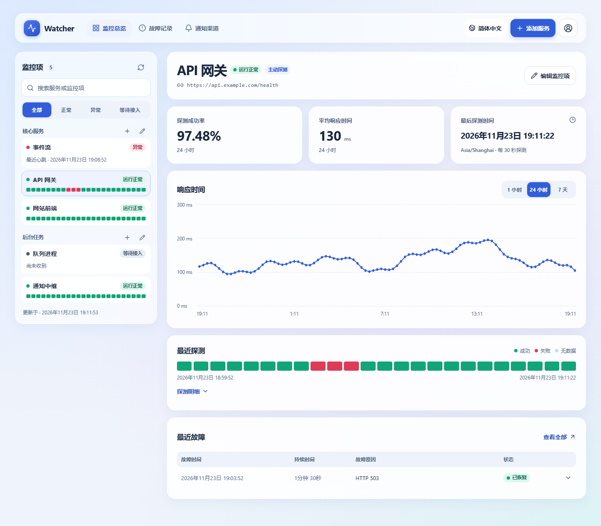

# Watcher

简体中文 · [English](README.md)

Watcher 监控 HTTP 接口和应用心跳，在服务故障及恢复时发送通知。控制台基于 Next.js、Tailwind CSS 和 PostgreSQL，支持简体中文和英文。任意 GitHub 用户登录后可查看监控数据。通过 `ADMIN_GITHUB_IDS` 指定可修改配置的 GitHub 用户。

## 界面预览

桌面端并排显示监控目录和所选监控项的详情。截图中的 API 网关展示了近 24 小时响应时间、近期探测结果和一条已恢复的故障。

手机端的监控总览集中展示当前异常和各监控项状态。点按监控项可进入详情，底部导航可切换总览、故障记录和通知渠道。

截图来自运行中的控制台，使用示例监控数据。

## 功能

- **主动 HTTP(S) 探测**每 30 秒检查一次公网地址，支持自定义预期 HTTP 状态码。连续两次失败时创建故障，下一次成功时关闭故障。
- **被动 WebSocket 监控**接受应用心跳与显式健康状态上报。首次有效上报后开始计时，15 秒未收到心跳时判定异常。
- **监控总览**按服务分组搜索、筛选监控项，查看最近探测和故障。主动探测支持 1 小时、24 小时和 7 天的响应时间图与探测成功率。探测明细保留 7 天。
- **告警投递**在故障和恢复时通过 Bark、Webhook 或邮件通知，记录各渠道的投递与重试结果。

## 本地运行

需要 Node.js 22.18 或更新版本，以及 PostgreSQL 14 或更新版本。

1. 克隆仓库，执行 `npm ci`，把 [`.env.example`](.env.example) 复制为 `.env.local`。
2. 创建 GitHub OAuth App。主页地址填写 `http://localhost:3000`，本地回调填写 `http://localhost:3000/api/auth/callback/github`。将 Client ID 和 Client Secret 分别写入 `AUTH_GITHUB_ID` 和 `AUTH_GITHUB_SECRET`。[GitHub OAuth App 创建文档](https://docs.github.com/en/apps/oauth-apps/building-oauth-apps/creating-an-oauth-app)
3. 为 `AUTH_SECRET` 和 `CHANNEL_SECRET_KEY` 各生成一个独立密钥。可分别运行 `node -e "console.log(require('node:crypto').randomBytes(32).toString('base64'))"`。将管理员的数字 GitHub 用户 ID 填入 `ADMIN_GITHUB_IDS`，多个 ID 用逗号分隔。
4. 设置 `DATABASE_URL` 并执行 `npm run db:migrate`。
5. 在不同终端运行 `npm run dev` 和 `npm run worker`。如需本地被动接入，在第三个终端运行 `npm run dev:ws`。打开 [本地控制台](http://localhost:3000)。

执行 `npm test` 可运行使用内嵌测试数据库的测试，无需外部 PostgreSQL。使用 `npm run typecheck` 检查类型，使用 `npm run build` 验证生产构建。

## 部署到 Vercel

使用 `vercel.json` 将 Next.js 和常驻监控进程部署到同一 Vercel 项目。默认区域是 `iad1`。若数据库位于其他地区，同步调整 `regions` 和 Daemon 的 `instances` 区域。Daemon 运行在生产环境。[Vercel Daemons 文档](https://vercel.com/docs/daemons)

1. 在 Vercel 创建项目并预留生产域名。设置生产环境变量，令 `AUTH_URL` 指向该 HTTPS 域名，并将 GitHub OAuth 回调设置为 `https://你的域名/api/auth/callback/github`。如需被动接入，确认项目已启用 Fluid compute。[Vercel WebSocket 文档](https://vercel.com/docs/functions/websockets)
2. 使用生产数据库连接执行 `npm run db:migrate`。将仓库关联到 Vercel 项目，再执行 `vercel --prod` 或通过项目的 Git 集成触发生产部署。部署后在 Vercel 日志确认 `Watcher 监控进程已启动`。
3. 管理员首次登录后，先创建通知渠道和服务，再为服务添加主动探测或被动监控项。可用自己的健康检查地址验证探测，用测试接收地址验证故障和恢复通知。

数据库连接和 `CHANNEL_SECRET_KEY` 供 Next.js 和 Daemon 共同使用。换部署时保留同一个 `CHANNEL_SECRET_KEY`，已有渠道密钥依赖它解密。发邮件所需的 `SMTP_*` 环境变量供 Daemon 使用。端口 `465` 直接使用 TLS，默认 `587` 使用 STARTTLS。

## 接入被动监控

生产地址为 `wss://你的域名/api/heartbeat`，本地地址为 `ws://127.0.0.1:3001/api/heartbeat`。创建被动监控项时保存一次性显示的令牌。客户端在握手头中发送 `Authorization: Bearer <令牌>`，每 5 秒发送一个 JSON 文本帧。平台持久化后返回 `{"type":"ack"}`。

| 帧 | 效果 |
| --- | --- |
| `{"type":"heartbeat"}` | 刷新存活时间，可解除心跳超时告警 |
| `{"type":"unhealthy"}` | 立即判定为显式异常 |
| `{"type":"healthy"}` | 上报健康并解除显式异常 |

客户端要在连接断开时自动重连，并尽快重新上报当前应用状态。服务端以收到上报的时间为准，达到 15 秒阈值后由常驻进程检查并创建告警。该进程每 250 毫秒扫描一次，生产环境实际判定和投递时间还受数据库、部署切换和通知服务延迟影响。处于「等待接入」的监控项从首次有效上报开始计时。

## 告警渠道

- **Bark** 填写应用中提供的含设备密钥的推送地址，例如 `https://api.day.app/设备密钥`。[Bark 文档](https://bark.day.app/)
- **Webhook** 填写公网 HTTP(S) 接收地址。平台发送 JSON，包含 `id`、`incidentId`、`event`、`service`、`monitor`、`reason` 和 `occurredAt`。`event` 为 `down` 或 `recovery`。接收方可使用 `Idempotency-Key` 请求头去重。
- **邮件** 填写收件邮箱。平台通过部署时配置的 SMTP 服务发送。

每个监控项可绑定多个渠道。单个渠道最多尝试三次。失败后分别在约 15 秒和 30 秒后重试。如果外部发送已成功但投递结果未能写入数据库，重试可能重复投递。

## 项目结构

- [`app/`](app/) 包含控制台、语言切换、认证入口和 API 路由。
- [`worker/`](worker/) 包含数据库结构、探测调度、心跳处理和告警投递。
- [`tests/`](tests/) 包含监控、告警及探测历史测试。

[首版监控规则](docs/monitoring.md) · [Vercel 调度决策](docs/adr/0001-vercel-daemon-for-scheduling.md)
